# VetLink · Salud animal, a un clic

> **Reto 3 — “Menos papeleo, más cuidado: los datos al servicio de la clínica”**
> VIII Hackathon Boehringer Ingelheim España · 13–15 de noviembre de 2026 · Equipo **Joniha**

VetLink convierte historias clínicas veterinarias dispersas en **una ficha única y compartible**, conecta a la clínica generalista con el **especialista** que necesita y entrega al especialista un **briefing pre-visita** antes de ver al paciente.

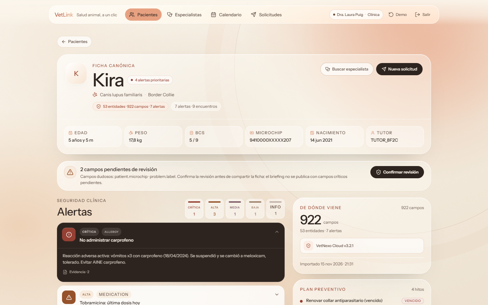

## Contexto de la hackathon

Este proyecto se desarrolló durante la **VIII Hackathon Boehringer Ingelheim España**, celebrada de forma virtual del **13 al 15 de noviembre de 2026** por el equipo **Joniha**.

El **Reto 3 — “Menos papeleo, más cuidado: los datos al servicio de la clínica”** planteaba tres necesidades conectadas:

1. **Normalizar** historias clínicas veterinarias que llegan en formatos distintos (Word, Excel, JSON y CSV).
2. **Conectar** a la clínica generalista con especialistas, con precio, disponibilidad, solicitud y agenda.
3. **Preparar la visita**: que el especialista reciba el contexto y el briefing antes de ver al paciente, con consentimiento y acceso auditado.

VetLink se construyó como respuesta a esos tres puntos en un único flujo: importar → ficha canónica → derivación → briefing → cierre.

> **Proyecto de hackathon.** Prototipo creado para la VIII Hackathon Boehringer Ingelheim España. No es un producto sanitario ni una aplicación lista para producción. Usa datos ficticios y autenticación de demostración; no debe usarse con datos reales hasta completar las garantías de seguridad y cumplimiento. Código bajo licencia MIT; avisos de terceros en [`THIRD_PARTY_NOTICES.md`](THIRD_PARTY_NOTICES.md).

## El problema

Laura es veterinaria generalista: no puede tener especialistas en plantilla y no sabe quién trabaja en su zona, qué ofrece, cuánto cuesta ni cuándo puede venir. Marc es especialista ambulante: cada clínica usa un software distinto y la historia del paciente le llega como Word, Excel, JSON o CSV, incompleta y desordenada. Los primeros minutos de cada visita los dedica a reconstruir el caso. **La información existe, pero no llega a tiempo.**

## La solución

1. **VetRecord · una historia, un formato.** La clínica sube Word, Excel, JSON o CSV. La API lo convierte a un registro canónico con procedencia por campo, confianza y alertas clínicas.
2. **VetNetwork · marketplace.** La clínica busca especialistas por especialidad y zona, consulta tarifa y disponibilidad, y solicita una derivación.
3. **VetBriefing · el puente.** Antes de aceptar, el especialista ve un resumen no identificativo. Al aceptar se desbloquean la historia completa y el briefing pre-visita. Todo acceso queda auditado.

## Arranque en 1 minuto

### Opción A — Python (Windows, macOS y Linux)

Requisitos: **Python 3.11+** y **Node.js 20+**. Node solo se usa la primera vez para compilar la interfaz.

```bash
python start.py
```

En macOS/Linux, si `python` apunta a Python 2, usa:

```bash
python3 start.py
```

El script:

- crea el entorno virtual;
- instala las dependencias de la API;
- compila la SPA si hace falta;
- arranca todo en un único proceso;
- abre `http://127.0.0.1:8000` en el navegador.

Si el puerto 8000 está ocupado, elige el siguiente libre. Para cambiar el puerto:

```bash
python start.py --port 8080
```

### Opción B — Docker (sin instalar Python ni Node)

¿Tienes Docker? Es la opción más portable:

```bash
docker compose up --build
```

Abre `http://127.0.0.1:8000`. Para parar: `Ctrl+C`.

### Opción C — desarrollo

Backend:

```bash
python -m venv .venv
# Windows: .venv\Scripts\activate
# macOS/Linux: source .venv/bin/activate
pip install -r services/api/requirements.txt
cd services/api
uvicorn app.main:app --reload --port 8000
```

Frontend, en otra terminal:

```bash
cd apps/web
npm install
npm run dev
```

La SPA de desarrollo está en `http://127.0.0.1:5173` y hace proxy de `/api` a `:8000`.

## Acceso a la demo

Login sin contraseña, con dos roles:

| Rol | Usuario | Qué puede hacer |
|---|---|---|
| Clínica | **Laura** | Importar historias, revisar alertas y solicitar derivaciones |
| Especialista | **Marc** | Recibir solicitudes, aceptar una franja y consultar el briefing |

El botón **Cargar demo** de la cabecera reinicia los datos de ejemplo.

## Capturas

| Importación multi-formato | Ficha clínica con alertas |
|---|---|
| 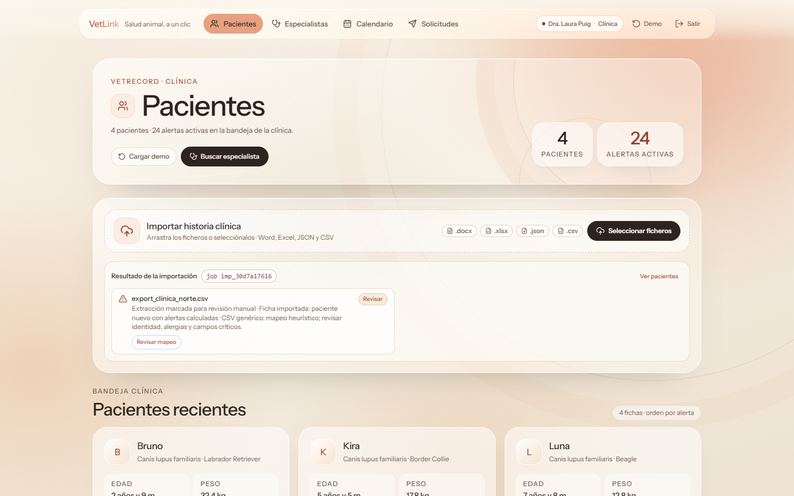 |  |

| Marketplace | Solicitud de derivación |
|---|---|
| 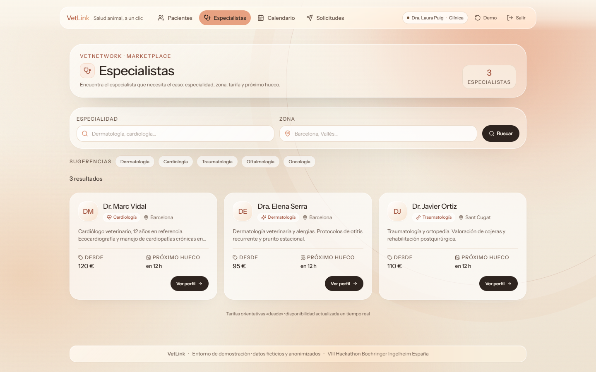 | 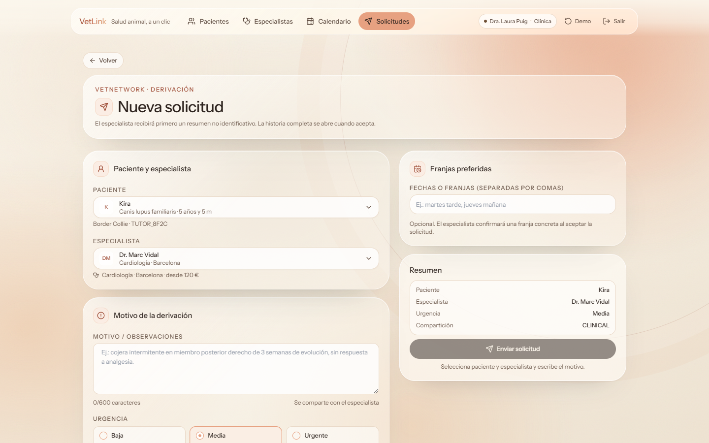 |

| Briefing pre-visita | Agenda |
|---|---|
| 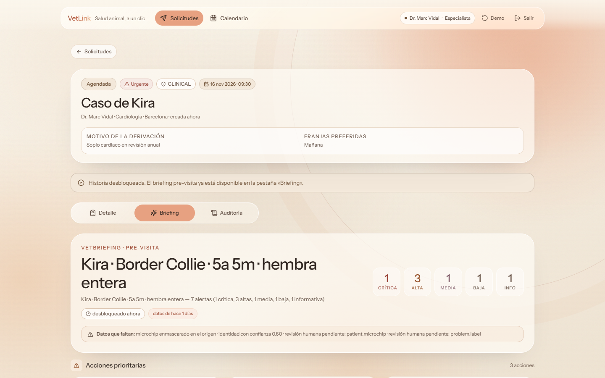 | 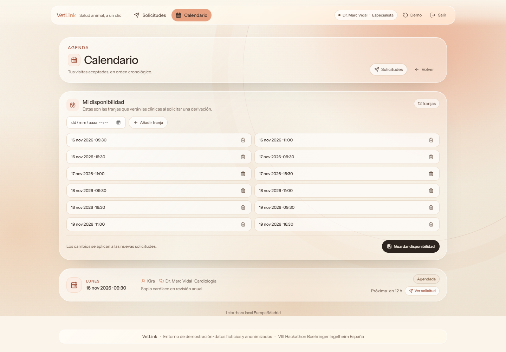 |

| Login por rol | Pacientes |
|---|---|
| 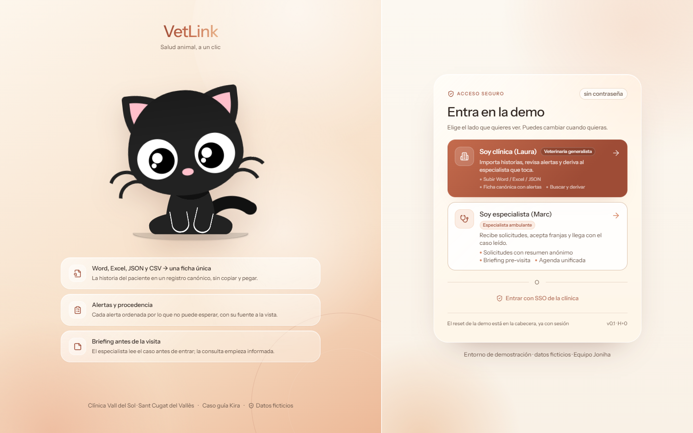 | 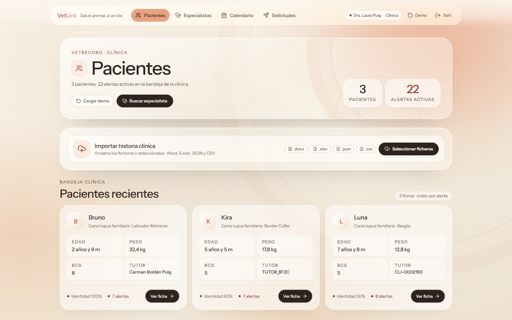 |

| Revisión del mapeo de columnas | Mi disponibilidad |
|---|---|
| 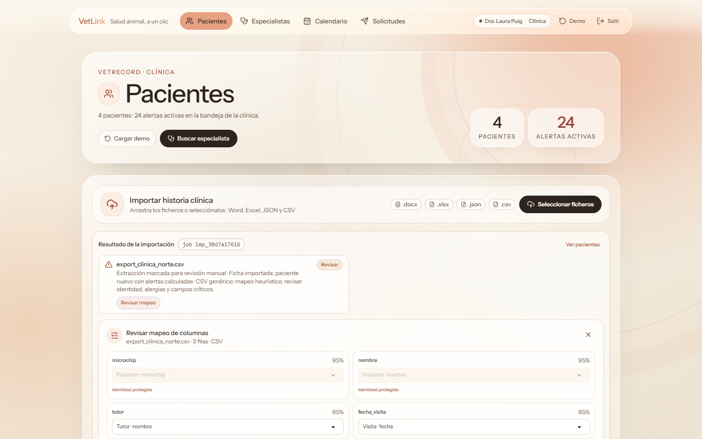 | 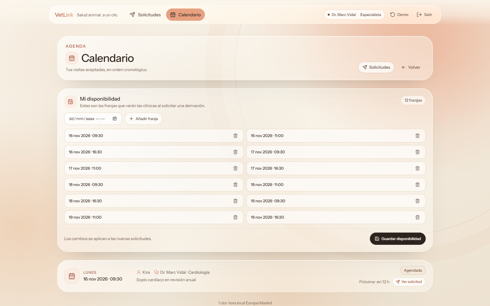 |

### Móvil

La ficha, las alertas y la navegación están preparadas para móvil:

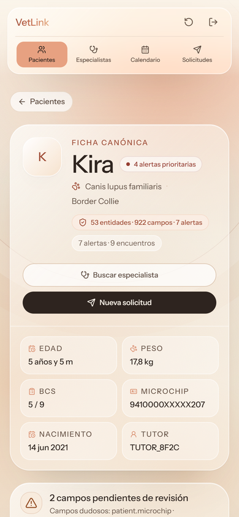

## Funcionalidades

- **Importación multi-formato:** Word, Excel, JSON y CSV; los cuatro ejemplos del reto entran por la misma API.
- **Variantes de Word, Excel y JSON:** mapeadores genéricos que extraen paciente, visitas, alergias y datos clínicos, y marcan la ficha para revisión.
- **CSV genérico:** las variantes de CSV se mapean por reglas y sinónimos, con conversión de fechas y pesos (kg/lb) y marca de revisión humana.
- **Registro canónico:** paciente, tutores, encuentros, problemas, alertas, vacunas, tratamientos y procedencia.
- **Alertas clínicas:** severidad ordenada (crítica → alta → media → baja → info), evidencia y acción recomendada.
- **Revisión humana:** campos dudosos señalados, mapeo de columnas editable y confirmación de la ficha antes de compartirla. Nombre y microchip no se pueden perder al confirmar.
- **Marketplace:** búsqueda por especialidad y zona, tarifa orientativa y siguiente hueco.
- **Derivación con consentimiento:** resumen no identificativo antes de aceptar; historia completa y briefing después.
- **Agenda:** cita confirmada al aceptar una franja; el especialista puede añadir o retirar sus franjas, y se bloquean citas duplicadas.
- **Cierre de visita:** nota del especialista que vuelve a la ficha de la clínica, con recomendaciones y próxima revisión.
- **Auditoría:** accesos y acciones relevantes registrados.

## Datos de ejemplo

En `data/samples/` están las historias anonimizadas del reto:

| Fichero | Paciente | Origen |
|---|---|---|
| `Clínica Veterinaria Vall del Sol.docx` | Bruno | Ficha manual de clínica |
| `export_MAS-0004587_anonimizado.xlsx` | Luna | Exportación de PMS |
| `historial.json` | Kira | API VetNexo Cloud |
| `export_clinica_norte.csv` | Nala | Export de otra clínica (4º formato) |

> Los ficheros exactos DOCX, XLSX y JSON se resuelven por caché y devuelven **Listo** sin duplicar datos. El CSV exacto entra por el mapeador genérico, crea a **Nala** y queda en **Revisar**.
>
> Las **variantes de CSV, JSON, Excel y Word** se procesan con mapeadores heurísticos y quedan marcadas para revisión humana.
>
> Prueba rápida del mapeador: sube `export_clinica_norte.csv` o cambia sus cabeceras (`nombre` → `nombre_completo`, `peso_lb` → `weight_lb`) y vuelve a subirlo. Se crea o actualiza **Nala** y queda en revisión.

## Arquitectura

Un solo proceso FastAPI sirve la SPA compilada y la API sobre SQLite y disco local; sin servicios externos en la demo. La API expone **27 rutas** en el contrato OpenAPI.


Flujo completo de usuarios, desde la revisión del mapeo hasta la nota de cierre:


**Stack:**

- **Frontend:** React 18 + Vite + TypeScript + Tailwind CSS + DaisyUI + React Router + TanStack Query.
- **Backend:** FastAPI + Pydantic + SQLModel.
- **Datos:** SQLite (demo) + documentos en disco. El modelo es portable a PostgreSQL.
- **Demo:** un único proceso; FastAPI sirve la SPA y la API en el mismo puerto.

## API

Contrato OpenAPI en [`contracts/openapi-v1.json`](contracts/openapi-v1.json) y documentación interactiva en `http://127.0.0.1:8000/docs`.

Bloques principales:

- `auth`: login/logout demo por rol.
- `patients`: bandeja y ficha canónica.
- `imports`: subida multi-fichero, estado por fichero y mapeo de columnas editable/confirmable.
- `specialists`: marketplace, perfil y edición de disponibilidad del especialista.
- `requests`: solicitud, resumen pre-aceptación, aceptación/declinación, briefing y cierre.
- `appointments` y `audit`: agenda y registro de accesos.
- `demo/reset`: reinicio de datos de ejemplo.

## Tests y calidad

Con el entorno ya creado por `start.py`:

```bash
# Windows
.venv\Scripts\python.exe -m pytest services/api/tests -q

# macOS/Linux
.venv/bin/python -m pytest services/api/tests -q
```

E2E de API (flujo completo clínica → especialista):

```bash
# Windows
powershell -ExecutionPolicy Bypass -File scripts/e2e-api.ps1

# macOS/Linux (requiere PowerShell 7)
pwsh -File scripts/e2e-api.ps1
```

Puertas de calidad: `ruff` sin avisos, **pytest 70/70**, 0 comentarios/TODO en el código (`scripts/check-code.ps1`) y **E2E 34/34**. También se verifican en navegador los cuatro formatos, la corrección de mapeo, la doble reserva, el cierre de visita y la disponibilidad.

## Estructura

```text
VetLink/
├── apps/web/              # SPA React + Vite + TypeScript + DaisyUI
├── services/api/          # FastAPI + SQLModel + SQLite
├── data/
│   ├── samples/           # historias de ejemplo
│   └── canonical/         # registros canónicos usados por el seed
├── contracts/             # contrato OpenAPI v1
├── docs/presentacion-final/ # presentación de la fase final
├── LICENSE                # licencia MIT del proyecto
├── LICENSES/              # textos de licencias de terceros
├── THIRD_PARTY_NOTICES.md # inventario completo de terceros
├── screenshots/           # capturas de la demo y diagramas
├── scripts/               # atajos de desarrollo y E2E
├── start.py               # arranque multiplataforma en un comando
├── compose.yaml           # demo con Docker
└── README.md
```

## Privacidad

Todos los datos son **ficticios y anonimizados**. El prototipo aplica mínimo privilegio: roles, niveles de compartición (`CLINICAL` / `FULL`), resumen no identificativo antes de aceptar, auditoría de accesos y aviso visible de entorno de demostración. En producción: clínica como responsable del tratamiento, VetLink como encargado (DPA), alojamiento en la UE y consentimiento informado del tutor (RGPD / LOPDGDD).

## Alcance y descargo

Este repositorio documenta un **prototipo de hackathon**, no un producto terminado:

- no es un dispositivo médico ni sustituye el criterio veterinario;
- el login es de demostración, sin SSO ni MFA de producción;
- los datos incluidos son ficticios y no deben sustituirse por datos reales;
- OCR/PDF, pagos reales, integraciones PMS y despliegue multi-cliente quedan fuera del MVP;
- antes de un uso real hacen falta seguridad, cumplimiento, consentimiento, retención y auditoría de producción.

## Presentación final

Resumen de 5 minutos para la fase final: idea, problema, demo, valor y nivel técnico. Incluye notas de ponente en cada diapositiva.

- [VetLink · presentación final (PPTX con notas)](docs/presentacion-final/VetLink-final-5min.pptx)
- [VetLink · presentación final (PDF)](docs/presentacion-final/VetLink-final-5min.pdf)

## Licencia

El código y la documentación original se distribuyen bajo **MIT**; consulta [`LICENSE`](LICENSE).

Las dependencias, la fuente Instrument Sans y los assets de terceros tienen sus propias licencias. El inventario completo y los textos están en [`THIRD_PARTY_NOTICES.md`](THIRD_PARTY_NOTICES.md) y [`LICENSES/`](LICENSES/). Instrument Sans se distribuye bajo SIL OFL 1.1.

MIT no concede derechos sobre las marcas **VetLink** ni **Boehringer Ingelheim**; consulta la nota de marcas en los avisos de terceros.

## Equipo

Equipo **Joniha** · Jose Miguel (producto, frontend y demo) y Rayan (backend y datos).

Reto 3 de la VIII Hackathon Boehringer Ingelheim España.


